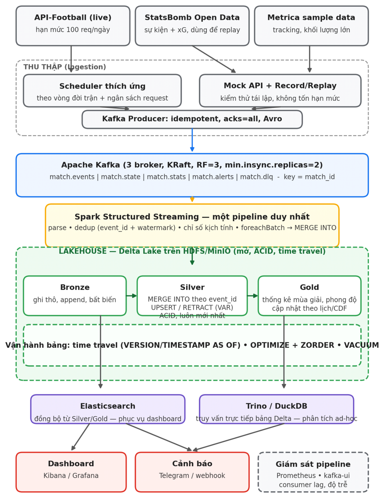

# Sports Lakehouse: Kafka + Spark Structured Streaming + Delta Lake cho dữ liệu bóng đá thời gian thực

Mã nguồn bài tập lớn môn **Dữ liệu lớn** (Nhóm 6, DAE1412, PTIT). Đề tài: *Ứng dụng Apache Kafka và Spark Streaming trên kiến trúc lakehouse để xử lý và phân tích dữ liệu thể thao trực tuyến theo thời gian thực*.

Toàn bộ hệ thống chạy trong Docker. Máy Windows chỉ cần Docker Desktop và PowerShell. Ở chế độ mặc định (**Mock**), hệ thống tự sinh 3 trận đấu giả lập, mỗi trận khoảng 13 phút, có tình huống VAR hủy bàn thắng và sửa tên người ghi bàn. Vì vậy chưa cần API key vẫn chạy được trọn luồng: thu thập, Kafka, Spark, Delta Lake, Elasticsearch, Grafana, cảnh báo.



---

## 1. Yêu cầu

| | Tối thiểu |
|---|---|
| Hệ điều hành | Windows 10/11 64-bit, có WSL 2 |
| Phần mềm | Docker Desktop 4.x (backend WSL 2), PowerShell 5.1 trở lên |
| RAM | 16 GB. Cần cấp cho Docker khoảng **11–12 GB** (xem bên dưới) |
| Ổ đĩa | Khoảng 15 GB trống (ảnh Docker ~6 GB, dữ liệu StatsBomb ~350 MB) |
| Internet | Cần khi build lần đầu và khi tải dữ liệu, sau đó chạy offline được |

**Cấp RAM cho Docker (WSL 2).** Mặc định WSL chỉ được dùng 50% RAM (8 GB), không đủ cho cả cụm. Tạo file `C:\Users\<tên bạn>\.wslconfig` với nội dung:

```ini
[wsl2]
memory=12GB
processors=6
swap=4GB
```

Sau đó chạy `wsl --shutdown` rồi mở lại Docker Desktop.

## 2. Chạy nhanh (khoảng 15 phút cho lần đầu)

Mở **PowerShell** trong thư mục dự án:

```powershell
# cho phép chạy script trong phiên PowerShell hiện tại
Set-ExecutionPolicy -Scope Process -ExecutionPolicy Bypass

.\manage.ps1 setup        # tạo file .env và thư mục data
.\manage.ps1 up           # build ảnh + khởi động cụm (lần đầu mất 5-10 phút)
.\manage.ps1 status       # xem trạng thái và địa chỉ các giao diện
.\manage.ps1 smoke --wait-mock 20   # kiểm tra toàn bộ luồng, chờ các trận Mock kết thúc rồi đối chiếu đáp án
```

Đợi 1–2 phút để pipeline Spark khởi động, sau đó mở:

| Giao diện | Địa chỉ | Ghi chú |
|---|---|---|
| **Grafana** | http://localhost:3000 | Dashboard *Trận đấu trực tiếp* và *Giám sát pipeline* (admin/admin) |
| Spark UI (pipeline) | http://localhost:4040 | Tab *Structured Streaming*: có 9 truy vấn đang chạy |
| Spark master | http://localhost:8080 | |
| Mock API | http://localhost:8000/_admin/scenarios | Danh sách trận giả lập, trạng thái, thời gian còn lại |
| MinIO (bảng Delta) | http://localhost:9001 | minioadmin / minioadmin123, bucket `lakehouse` |
| Prometheus | http://localhost:9090 | |
| Kibana, kafka-ui | http://localhost:5601, :8085 | Chỉ có khi chạy `.\manage.ps1 up -Ui` |

Các lệnh kiểm tra nhanh:

```powershell
.\manage.ps1 logs collector                 # collector gọi Mock API, suy ra sự kiện
.\manage.ps1 logs spark-pipeline            # pipeline: MERGE INTO, cảnh báo
.\manage.ps1 query --list                   # số dòng các bảng bronze/silver/gold
.\manage.ps1 query --preset live            # tỷ số các trận
.\manage.ps1 query --preset corrections     # sự kiện bị sửa / thu hồi (VAR)
.\manage.ps1 query --preset alerts          # cảnh báo V1/V2
.\manage.ps1 gold                           # chạy job gold ngay (bình thường tự chạy 10 phút/lần)
.\manage.ps1 query --preset standings
.\manage.ps1 mock-restart 4 2 10            # tạo lại 4 trận giả lập, cách nhau 2 phút, tốc độ x10
```

Dừng cụm: `.\manage.ps1 down` (giữ dữ liệu). Xóa sạch để chạy lại từ đầu: `.\manage.ps1 reset`.

## 3. Ba chế độ vận hành

### Mock (mặc định)
`COLLECTOR_MODE=mock` trong `.env`. Mock API mô phỏng đúng đường dẫn, tham số, định dạng phản hồi và hạn mức của API-Football (100 request/ngày, 10 request/phút, có header `x-ratelimit-*`). Một số tùy chọn:

- `MOCK_SPEED=10`: đồng hồ trận chạy nhanh gấp 10 lần.
- `MOCK_SCENARIO_SOURCE=statsbomb`: dùng diễn biến thật của các trận StatsBomb đã tải, thay cho trận tự sinh.
- `MOCK_VAR_PROB`: xác suất có VAR hủy bàn thắng trong mỗi trận.

### Live (API-Football thật)
1. Đăng ký gói Free tại https://dashboard.api-football.com và lấy API key.
2. Mở `.env`, đặt `APIFOOTBALL_KEY=<key>` và `COLLECTOR_MODE=live`. Có thể chỉnh `LEAGUE_IDS` (39 = Ngoại hạng Anh, 140 = La Liga, 2 = Champions League).
3. `.\manage.ps1 restart collector`. Lệnh này tạo lại container để nạp cấu hình mới. Lệnh `docker compose restart` thuần **không** đọc lại `.env`.

Bộ lập lịch thích ứng tự chia 100 request/ngày theo lịch thi đấu trong ngày. Mọi phản hồi được lưu vào `data/raw/apifootball/` để phát lại về sau.

### Replay (dữ liệu lịch sử, kiểm thử tải)

```powershell
.\manage.ps1 download                                   # World Cup 2022 + Euro 2024 (30 trận mỗi giải) + Metrica
.\manage.ps1 download --sb-seasons 2:27 --max-matches 0 # thêm cả mùa Ngoại hạng Anh 2015/16 (380 trận, ~1,3 GB)

# Phát lại sự kiện StatsBomb (mọi sự kiện, ~3.500/trận), 4 trận song song, nhanh gấp 10
.\manage.ps1 replay-sb --competition 43 --season 106 --matches 4 --speed 10
# Kiểm thử tải: tất cả trận đã tải, x1000, gắn hậu tố id để thành dữ liệu mới
.\manage.ps1 replay-sb --all-downloaded --matches 0 --parallel 16 --speed 1000 --id-suffix load1

# Dữ liệu vị trí 25 Hz (Metrica): ~145.000 khung hình, ~3,3 triệu bản ghi vị trí mỗi trận
.\manage.ps1 replay-tracking --game 1 --speed 200 --workers 4

# Phát lại phản hồi API đã ghi (từ Live hoặc Mock)
# đặt COLLECTOR_MODE=replay trong .env (REPLAY_RAW_SOURCE=mock|apifootball, REPLAY_SPEED=10), rồi:
.\manage.ps1 restart collector
```

## 4. Cấu trúc mã nguồn và đối chiếu với đề cương

```
sports-lakehouse/
├── docker-compose.yml          # cụm 20 dịch vụ (Kafka x3, Spark, MinIO, ES, Grafana, ...)
├── manage.ps1                  # lệnh tiện ích cho Windows
├── .env.example                # mọi cấu hình (copy thành .env)
├── schemas/*.avsc              # lược đồ Avro có phiên bản (Schema Registry, BACKWARD)
├── docker/                     # Dockerfile ảnh Python và ảnh Spark (Delta, Kafka, Avro, S3A)
├── config/                     # Prometheus, Grafana (datasource + 2 dashboard)
├── src/sportslake/
│   ├── ingestion/
│   │   ├── apifootball.py      # client API-Football v3
│   │   ├── scheduler.py        # bộ lập lịch thích ứng theo vòng đời trận + ngân sách
│   │   ├── differ.py           # so sánh ảnh chụp -> sự kiện mới / sửa / RETRACT
│   │   ├── collector.py        # vòng lặp thu thập (mock / live / replay), producer idempotent
│   │   ├── recorder.py         # ghi phản hồi thô để Replay
│   │   ├── statsbomb.py        # đọc & chuẩn hóa StatsBomb, nhãn khoảnh khắc then chốt
│   │   ├── replay_statsbomb.py # phát lại sự kiện lịch sử x1..x1000
│   │   ├── replay_tracking.py  # phát lại dữ liệu vị trí 25 Hz (đa tiến trình)
│   │   └── inject.py           # luồng kiểm thử có đáp án (trùng, sửa, thu hồi, đảo thứ tự, lỗi)
│   ├── mock_api/               # Mock API-Football (FastAPI) + kịch bản trận, VAR, sửa dữ liệu
│   ├── streaming/
│   │   ├── pipeline.py         # MỘT ứng dụng Spark streaming, 9 truy vấn: bronze, silver MERGE INTO, DLQ,
│   │   │                       #   kịch tính, outbox cảnh báo, đồng bộ ES, bảo trì (job gold chạy riêng)
│   │   ├── transforms.py       # biến đổi DataFrame (giải mã Avro, kiểm tra chất lượng, loại trùng)
│   │   ├── merge_sql.py        # biểu thức MERGE INTO (upsert / bia mộ RETRACT)
│   │   ├── tables.py           # định nghĩa bảng Delta bronze/silver
│   │   └── es_sync.py          # Change Data Feed -> Elasticsearch
│   ├── analytics/excitement.py # chỉ số kịch tính V1 (luật) / V2 (chấm điểm)
│   ├── batch/                  # job gold (incremental qua CDF), lập lịch job, công cụ Spark SQL/time travel
│   ├── serving/                # alerter (Telegram/webhook/ES), truy vấn DuckDB trên Delta
│   ├── experiments/            # E1, E2, E3, E5, E6, E8
│   └── tools/                  # khởi tạo hạ tầng, tải dữ liệu, quản trị
├── scripts/experiments/*.ps1   # kịch bản chạy thí nghiệm (gồm cả gây sự cố cho E3)
├── tests/                      # unit test (pytest)
└── docs/                       # kiến trúc, thí nghiệm, gợi ý viết báo cáo
```

| Nội dung trong đề cương | Vị trí trong mã nguồn |
|---|---|
| 3 chế độ Live / Replay / Mock, hạn mức API | `ingestion/collector.py`, `mock_api/`, `ingestion/replay_*.py` |
| Bộ lập lịch gọi API thích ứng | `ingestion/scheduler.py` |
| So sánh ảnh chụp, suy ra sự kiện mới / đổi / thu hồi | `ingestion/differ.py` |
| Kafka KRaft 3 broker, Avro + Schema Registry, producer idempotent | `docker-compose.yml`, `schemas/`, `kafka_io.py` |
| Pipeline xử lý luồng: một ứng dụng Spark chạy nhiều truy vấn streaming (job gold chạy riêng theo lịch), loại trùng theo `event_id` + watermark | `streaming/pipeline.py`, `streaming/transforms.py` |
| `foreachBatch` + `MERGE INTO` (cập nhật / RETRACT / thêm mới) | `EventsProcessor` trong `pipeline.py`, `merge_sql.py` |
| Bronze (append, bất biến) – silver (hợp nhất) – gold (tổng hợp) | `streaming/tables.py`, `batch/gold_job.py` |
| Gold đọc gia tăng từ silver qua Change Data Feed | `batch/gold_job.py` (chế độ `incremental`) |
| Quy tắc chất lượng (bàn thắng khớp tỷ số, phút không lùi), dead-letter `match.dlq` | `transforms.dq_*`, `_consistency_check`, `StateProcessor` |
| Time travel, OPTIMIZE + ZORDER BY match_id, VACUUM | `Maintenance` trong `pipeline.py`, `batch/spark_tools.py`, `experiments/e8_time_travel.py` |
| Chỉ số kịch tính, cảnh báo Telegram/webhook | `analytics/excitement.py`, `serving/alerter.py` |
| Elasticsearch cho dashboard, DuckDB truy vấn ad-hoc trên Delta | `streaming/es_sync.py`, `serving/query.py` |
| Giám sát consumer lag, độ trễ, số bản ghi DLQ | `ProgressMonitor`, Prometheus, dashboard *Giám sát pipeline* |
| Thí nghiệm E1, E2, E3, E5, E6, E8 | `experiments/`, `scripts/experiments/` |

Đề cương ghi "Trino hoặc DuckDB" và "HDFS/MinIO". Mã nguồn chọn **DuckDB** (truy vấn trực tiếp bảng Delta qua thư viện `deltalake`, không cần metastore) và **MinIO** (giao diện S3). Hai lựa chọn này nhẹ hơn nhiều khi chạy trên laptop. Lý do chi tiết nằm trong `docs/kien-truc.md`.

## 5. Thí nghiệm

Chi tiết từng thí nghiệm có trong `docs/thi-nghiem.md`. Kết quả (CSV, JSON, PNG) được lưu vào `data/experiments/results/`.

| Mã | Lệnh | Thời gian | Cần cụm chạy? |
|---|---|---|---|
| E1 độ trễ theo khâu (RQ1) | `.\manage.ps1 exp e1` | ~40 phút | Có |
| E2 thông lượng, mở rộng | `.\manage.ps1 exp e2` | ~1,5 giờ (18 cấu hình) | Có |
| E3 chịu lỗi, đúng-một-lần, VAR (RQ2) | `.\manage.ps1 exp e3` | ~10 phút | Có |
| E5 lịch gọi thích ứng (RQ3) | `.\manage.ps1 exp e5` | < 1 phút | Không (mô phỏng offline) |
| E6 phát hiện nổi bật (RQ4) | `.\manage.ps1 exp e6` | < 1 phút | Không (offline) |
| E8 kiểm tra bằng time travel | `.\manage.ps1 exp e8` | 1 phút | Có (sau vài trận Mock) |

Muốn đổi tham số thì gọi trực tiếp script, ví dụ: `.\scripts\experiments\e2.ps1 -Partitions 3,12 -Cores 1,3 -Speeds 500`.

**Kết quả mẫu đã chạy (offline) trên 115 trận World Cup 2022 + Euro 2024:**

*E5: ngân sách 100 request/ngày, 45 ngày thi đấu thật, độ trễ nhà cung cấp 20 giây (giá trị trung bình theo ngày):*

| Chính sách | Request/ngày | Sự kiện bỏ lỡ | Trễ p50 (mọi sự kiện) | Trễ p50 bàn thắng | Trễ p95 bàn thắng |
|---|---|---|---|---|---|
| Thích ứng | 94,0 | 0,0 | 101,5 s | 105,8 s | 194,2 s |
| Cố định (chia đều ngân sách) | 95,6 | 0,0 | 119,5 s | 126,4 s | 184,4 s |
| Cố định 60 giây | 98,7 | 20,9 | 189,4 s | 211,4 s | 649,1 s |

Với cùng ngân sách, lịch thích ứng giảm độ trễ trung vị khoảng 15% (bàn thắng: khoảng 16%) nhờ không gọi trong giờ nghỉ và dồn request về cuối trận. Đổi lại, đuôi p95 dài hơn khoảng 10 giây. Lịch cố định 60 giây hết ngân sách giữa ngày và bỏ lỡ trung bình 21 sự kiện mỗi ngày.

*E6: ngưỡng V2 được chọn trên World Cup 2022 (64 trận, tập điều chỉnh), kết quả báo cáo trên Euro 2024 (51 trận, tập kiểm tra tách biệt, 171 khoảnh khắc then chốt). Ngưỡng được chọn là 7,0:*

| Phiên bản (tập kiểm tra) | Cảnh báo/trận | Precision | Recall | F1 | Recall cơ hội lớn |
|---|---|---|---|---|---|
| V1 luật | 2,61 | 1,000 | 0,778 | 0,875 | 0,026 |
| V2 chấm điểm | 1,82 | 0,849 | 0,462 | 0,598 | 0,436 |
| V1 + V2 (cấu hình triển khai) | 3,25 | 0,904 | 0,877 | **0,890** | 0,462 |

Quy tắc "V2 không báo nếu V1 vừa báo trong 60 giây" nằm trong `analytics/excitement.py` và được dùng chung cho pipeline lẫn đánh giá offline. Bước đánh giá không có thêm bước gộp cảnh báo nào khác.

Biểu đồ và CSV của hai thí nghiệm này có sẵn trong `docs/ket-qua-mau/`. Cách tái lập đúng các con số trên được ghi trong `docs/ket-qua-mau/README.md`.

Nhãn được suy ra từ chính dữ liệu sự kiện, nên V1 đúng gần như tuyệt đối với các loại sự kiện nó dựa vào. Đóng góp của V2 là bắt thêm "cơ hội lớn" mà luật không thấy, đổi lại precision giảm. Khi viết báo cáo cần nêu rõ hạn chế này. Kết quả quét ngưỡng nằm trong `e6_highlight_v2_sweep.csv`.

## 6. Truy vấn và time travel

```powershell
# DuckDB trên bảng Delta (đọc thẳng từ MinIO)
.\manage.ps1 query "SELECT category, count(*) n FROM silver_match_events GROUP BY 1 ORDER BY n DESC"
.\manage.ps1 query --version silver_match_events=5 "SELECT count(*) FROM silver_match_events"   # time travel

# Spark SQL (VERSION AS OF / lịch sử phiên bản)
.\manage.ps1 spark-sql history silver.match_events
.\manage.ps1 spark-sql time-travel silver.match_events --version 5
.\manage.ps1 spark-sql sql "SELECT * FROM gold_standings"
```

## 7. Cảnh báo qua Telegram (tùy chọn)

1. Trên Telegram, nhắn cho `@BotFather` lệnh `/newbot` để lấy token.
2. Nhắn một tin bất kỳ cho bot vừa tạo, sau đó mở `https://api.telegram.org/bot<token>/getUpdates` để lấy `chat.id`.
3. Điền `TELEGRAM_BOT_TOKEN` và `TELEGRAM_CHAT_ID` vào `.env`, rồi chạy `.\manage.ps1 restart alerter`.

## 8. Xử lý sự cố

| Hiện tượng | Cách xử lý |
|---|---|
| `init` thoát với lỗi, các dịch vụ khác không chạy | `.\manage.ps1 logs init`. Thường do Kafka hoặc Elasticsearch khởi động chậm, chạy lại `.\manage.ps1 up` |
| `spark-pipeline` khởi động lại liên tục | `.\manage.ps1 logs spark-pipeline`. Nếu gặp `OutOfMemory`, tăng `memory` trong `.wslconfig` hoặc giảm `PIPELINE_CORES_MAX` |
| Spark UI không có executor | Worker chưa đăng ký: `docker compose restart spark-worker`, rồi kiểm tra http://localhost:8080 |
| Cổng 9000, 8080 hoặc 3000 đã bị dùng | Đổi phần `ports` trong `docker-compose.yml` (vế trái là cổng trên máy) |
| Build lỗi khi tải JAR từ Maven | Do mạng: build lại `docker compose build --no-cache spark-master` |
| Grafana trống | Chọn khoảng thời gian *Last 6 hours*. Mock cần vài phút mới có sự kiện. Bảng xếp hạng có sau lần chạy gold đầu tiên |
| Đã sửa `.env` mà dịch vụ vẫn chạy cấu hình cũ | Dùng `.\manage.ps1 restart <dịch vụ>` (tạo lại container), không dùng `docker compose restart` |
| Collector báo "Hết hạn mức" | Ở Mock: `.\manage.ps1 mock-restart`. Ở Live: chờ sang ngày mới (UTC) |
| Muốn xóa sạch để chạy lại | `.\manage.ps1 reset` |
| Script `.ps1` không chạy | `Set-ExecutionPolicy -Scope Process -ExecutionPolicy Bypass` |

## 9. Kiểm thử

```powershell
.\manage.ps1 test
```

Bộ test (48 test, gồm 5 test Spark) kiểm tra:
- differ: sự kiện mới, sửa tên cầu thủ (kể cả khi giữ nguyên id), VAR hủy bàn, khóa trùng phút, hoàn tác trạng thái;
- collector: chỉ lưu trạng thái khi Kafka đã xác nhận; gửi lỗi thì hoàn tác và gửi lại; khởi động lại không gửi trùng;
- bộ lập lịch: giờ nghỉ, ngân sách, giới hạn theo phút, dùng phần dự phòng để chốt trận;
- Mock API: hạn mức, định dạng; differ theo dõi cả trận phải hội tụ đúng đáp án với 8 kịch bản có VAR;
- Avro round-trip và tương thích BACKWARD;
- **ngữ nghĩa MERGE INTO** (cùng biểu thức với pipeline, chạy bằng delta-rs): luồng có trùng, sửa, thu hồi, đảo thứ tự phải hội tụ; chạy lại mỗi vi lô hai lần phải cho kết quả giống hệt, kể cả `version_count`; RETRACT cùng `seq` thắng UPSERT và áp lại không đổi gì;
- đồng bộ Elasticsearch: lỗi tạm thời làm vi lô thất bại để chạy lại, lỗi 4xx được ghi nhật ký;
- chỉ số kịch tính và quy tắc chặn V2 ngay sau V1.

Các phép biến đổi Spark và bảng gold có test riêng (`tests/test_spark_transforms.py`), test này tự bỏ qua nếu môi trường không có pyspark.

**Các test trên chưa thay thế được kiểm thử tích hợp trên cụm thật.** Sau khi `up`, hãy chạy `.\manage.ps1 smoke --wait-mock 20`. Lệnh này kiểm tra hạ tầng, 9 truy vấn streaming, dữ liệu silver, việc mọi cảnh báo đã tới Elasticsearch, và đối chiếu các trận Mock đã kết thúc với đáp án `/_admin/truth` (sự kiện cuối, VAR, sửa tên, tỷ số). Tiếp theo chạy `.\manage.ps1 exp e3`: thí nghiệm này lặp lại phép đối chiếu trong lúc gây sự cố ở broker, worker và driver.

## 10. Gợi ý chia việc trong nhóm

| Phần | Mã nguồn | Thí nghiệm | Chương báo cáo |
|---|---|---|---|
| Thu thập: Mock/Live/Replay, bộ lập lịch | `ingestion/`, `mock_api/` | E5 | 3.2, 3.5 |
| Xử lý luồng và lakehouse | `streaming/`, `batch/` | E2, E3, E8 | 3.4, 3.6 |
| Phục vụ, kịch tính, giám sát | `analytics/`, `serving/`, `config/` | E1, E6 | 3.7, 3.8 |

Mỗi người nên tự chạy được toàn bộ cụm trên máy mình (`.\manage.ps1 up`) trước khi chia nhau đi sâu vào phần riêng.

## 11. Nguồn dữ liệu

- **StatsBomb Open Data**: https://github.com/statsbomb/open-data. Khi dùng phải ghi nguồn "Data provided by StatsBomb" và tuân thủ điều khoản trong repo.
- **Metrica Sports sample data**: https://github.com/metrica-sports/sample-data
- **API-Football v3**: https://www.api-football.com (gói Free: 100 request/ngày).
